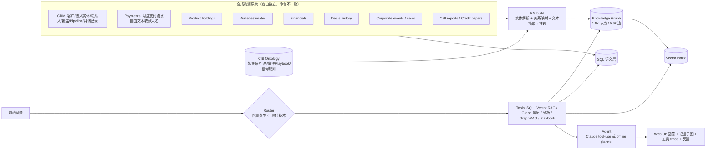

# Frontline Client Intelligence Graph：Ontology Agent Demo

这个 Demo 用来验证一个假设：**一套共享的 CIB 客户本体（ontology）加知识图谱，能否把客户、关系、交易、产品和事件这些今天在 RAG 和各套分析方案里互相割裂的信号连起来，从而明显提升前线的商机洞察质量。**

Demo 里的数据全部是合成的，公司和人名均为虚构。需求提到的每一类数据都有对应的合成数据，三个 lighthouse 实验和 8 类问题的路由也都已实现，可以直接运行。

 

---

## 1. 快速开始

```bash
# 核心功能只依赖 Python 3.10+ 标准库
python -m ontology_agent serve            # 打开 http://127.0.0.1:8000
python -m ontology_agent ask "How are Aurora Logistics and Harrowgate Steel Trading connected?" --trace
python -m ontology_agent ask "Kestrel Auto Components 有哪些交叉销售机会？"
python -m ontology_agent experiments      # 运行 3 个 lighthouse 实验，结果写入 reports/
python -m unittest discover -s tests      # 测试

# 可选：重新生成合成数据 / 查看建图质量 / 导出 OWL
python -m ontology_agent generate
python -m ontology_agent build
python -m ontology_agent export-ontology  # -> ontology/cib_client_ontology.ttl
```

**启用 Claude（可选）：** 先 `pip install -r requirements.txt`，再设置 `ANTHROPIC_API_KEY`，Agent 会自动切换到 Claude（`claude-opus-5-5`，开启 adaptive thinking 和 server-side refusal fallback）。这时由 Claude 自主选择调用哪些工具，并写出带证据引用的回答。没有配置 Key 时，使用确定性的 offline planner：工具完全相同，回答用模板生成，因此演示和实验结果都可复现。

---

## 2. 架构



| 层 | 文件 | 说明 |
|---|---|---|
| 本体 | `ontology_agent/ontology.py`, `ontology/cib_client_ontology.ttl` | 20 个类、33 个关系（含 3 个推理关系）、15 个产品（GB/TB/Markets）、**事件→商机 Playbook**、**交叉销售信号规则**。所有入图的边都要通过 domain/range 校验。 |
| 合成数据 | `ontology_agent/synth/generate.py` → `data/source_systems/` | 按源系统分别落盘（CSV / JSONL）。另有隐藏的 `data/ground_truth/` 只供实验打分，Agent 不读取。 |
| 建图 | `ontology_agent/kg/build.py`, `kg/store.py` | 三层实体解析（精确 → 模糊 → 缩写+国家），把支付流水里的自由文本收款人、前雇主、董事席位、合资方解析到主数据实体；从拜访报告中抽取 intent（能识别否定，如 "not interested in FX hedging"）；推理出 `ULTIMATE_PARENT`、`SUPPLIER_OF`、`TRADES_WITH`。 |
| 引擎 | `engines/semantic_sql.py`, `vector.py`, `analytics.py` | 受治理的指标 SQL；TF-IDF 向量检索；图分析（NBA 信号、事件 Playbook、多跳路径、关系覆盖、组合变化）。每个结果都附带证据。 |
| Agent | `agent/router.py`, `tools.py`, `offline.py`, `llm.py` | 问题路由（中英文）+ 实体链接；17 个工具同时供 Claude 和 offline planner 使用。 |
| UI | `web/server.py`, `web/static/index.html` | 纯标准库 HTTP 服务加单页应用：问答、路由表高亮、证据子图（可点击/展开）、工具 trace、👍/👎 反馈（用于计算 banker acceptance）、本体浏览、实验报告。 |

---

## 3. 需求中的数据类型 → 合成数据

| 需求里提到的数据 | 合成数据（`data/source_systems/`） | 规模 | 在本体中的映射 |
|---|---|---|---|
| clients / complex client groups | `crm_client_groups.csv` | 30 个集团，其中 15 个为多层多国复杂集团 | `ClientGroup` |
| legal entities / subsidiaries | `crm_legal_entities.csv` | 139 个法人实体（最终母公司 → 区域控股 → 运营子公司，含持股比例） | `LegalEntity`, `SUBSIDIARY_OF`, `BELONGS_TO_GROUP` |
| contacts | `crm_contacts.csv` | 189 人（含前雇主、董事席位） | `Contact`, `WORKS_AT`, `PREVIOUSLY_WORKED_AT`, `DIRECTOR_OF` |
| bankers / coverage | `crm_bankers.csv`, `crm_coverage.csv` | 12 名银行家（RM、GB/TB/Markets 产品专家） | `Banker`, `COVERS` |
| banker interactions | `crm_interactions.csv` | 736 次触达 | `Interaction`, `WITH_CONTACT`, `BY_BANKER` |
| call reports | `documents/call_reports.jsonl` | 163 份（含意图、拒绝、竞争对手报价等信号） | `CallReport`, `EXPRESSES` → `Intent` |
| credit papers | `documents/credit_papers.jsonl` | 30 份 | `CreditPaper` |
| payments / flows | `payments_monthly_flows.csv` | 3,144 行月度流水（收款人名有约 60% 写法不一致，另有乱码） | `PAYS`（聚合成 12 个月序列） |
| product holdings | `product_holdings.csv` | 250 条 | `HOLDS` |
| wallet | `wallet_estimates.csv` | 30 × 3 个产品族 × 2 年 | `WalletEstimate` |
| pipeline | `crm_pipeline.csv` | 28 个商机 | `Opportunity` |
| historical deals | `deals_history.csv` | 139 笔（部分可追溯到触发事件） | `Deal`, `ORIGINATED_FROM` |
| corporate events | `news_corporate_events.csv` | 42 个历史事件和 8 个近期事件，覆盖 10 类事件 | `CorporateEvent` |
| 财务（收入等） | `finance_financials.csv` | 3 年 | SQL 语义层 |
| 外部公司 / JV | `ref_external_companies.csv`, `ref_joint_ventures.csv` | 22 家，含供应商、并购标的和 PE | `ExternalCompany`, `JV_PARTNER_WITH` |

---

## 4. 问题类型 → 最佳技术（需求中的表格）

Router（`agent/router.py`）先给问题分类并做实体链接，再交给对应的工具链处理。中文问题同样支持。

| 问题 | 技术 | 实现 |
|---|---|---|
| "Find the latest call report" | Search / vector RAG | `search_documents(latest=true)` |
| "Summarise this credit paper" | LLM + RAG | `get_document`，由 Claude 摘要（离线时为抽取式摘要） |
| "What's Client X's revenue?" | SQL / semantic layer | `query_metric`：受治理的指标定义，回答中给出所用 SQL |
| "What products does Client X have?" | SQL / graph | `ClientGroup <- LegalEntity -HOLDS-> Product` |
| "What opportunity is implied by Client X's subsidiaries, flows, wallet and recent events?" | Graph + analytics + LLM | `cross_sell_signals` + `event_opportunities` |
| "How are Client A and Company B connected?" | Graph | `find_connections`：多跳可解释路径（JV、供应商付款、共同董事、前雇员、交易、文档） |
| "What similar deals have we executed for related clients?" | GraphRAG | `related_parties_and_deals`：先在图上扩展出关联方，再取回交易 |
| "What changed across my portfolio and what should I do?" | Graph + analytics + agent | `portfolio_changes`：事件、流水异动、客户意图、pipeline、覆盖缺口，并给出排好优先级的行动建议 |

另外补充了两类：**Relationship（多跳关系问题）**和 **Event（单个事件 → 商机）**，分别对应实验 3 和实验 2。

---

## 5. 三个 Lighthouse 实验

```bash
python -m ontology_agent experiments   # -> reports/experiment_results.md / .json
```

> ⚠️ **结果如何解读：** 合成数据里的隐藏 ground truth 是用与图谱相同类型的信号生成的，并加入了噪声：约 25% 的需求在任何数据源里都看不到，部分信号只出现在某一个源，事件后也会出现 playbook 预测不到的交易。所以这些数字只能证明**管道能端到端跑通、评估方法可行**，**不能证明业务假设本身**。真实验证需要换成真实数据重新跑一遍，评估代码可以直接复用。

### 实验 1：Cross-sell / Next Best Action（25 个客户）
数据源：支付流水、产品持有、wallet、pipeline、拜访报告，外加股权结构和同业。对照基线是 "today's opportunity identification"，即 pipeline 加上产品缺口热门度。

| 方法 | Precision@3 | Recall | 非 pipeline 的新增命中 | 推荐了客户已拒绝的产品 |
|---|---|---|---|---|
| **Graph NBA（所有源连接）** | **0.347** | **0.812** | **18** | **0** |
| 今天：pipeline + 产品缺口 | 0.24 | 0.562 | 10 | 1 |
| 消融：只用 payments | 0.2 | 0.469 | 11 | 0 |
| 消融：只用 call reports | 0.213 | 0.5 | 11 | 0 |

消融实验说明，**提升来自把多个数据源连起来**，单独用任何一个源都达不到这个效果。每条推荐都附带证据，例如：“USD 42m/yr 的 VND 供应商付款，功能货币为 SGD，且未在本行做 FX 对冲”。客户明确拒绝的产品会被抑制；杠杆率 ≥ 3.5x 时，信贷闸门会拦截新增杠杆类产品。

### 实验 2：Event → Opportunity（42 个历史事件）
对每个事件，用本体中的 playbook，结合**事件发生当日**的图谱状态（持有产品、所在国家、杠杆率、评级、行业、近期 M&A 委任）评估条件，与事件后实际发生的 GB/TB/Markets 交易对比。基线是新闻提醒：只按事件类型给出一份通用产品清单。

| 方法 | Precision | Recall | F1 |
|---|---|---|---|
| **Graph（playbook × 客户上下文）** | **0.805** | 0.897 | **0.848** |
| 今天：新闻提醒 → 通用产品清单 | 0.587 | 0.91 | 0.714 |

图谱方法的召回略低于基线（0.897 对 0.91），但精度显著更高：它会剔除不合适的推荐，例如杠杆 5.0x 时不推 Acquisition Finance，在当地已有账户时不推 Cash Management。**Banker acceptance** 通过 UI 里的 👍/👎 记录到 `data/feedback.jsonl`，实验报告会自动按路由统计。我们没有编造 acceptance 数字，这项指标留给试点期间由真实银行家填写。

### 实验 3：Relationship Intelligence（15 个复杂集团，75 个多跳问题）
5 类问题：哪些实体持有某产品、A 与 B 如何关联、6 个月内没见过的联系人、谁和 CFO 关系最好、我们为其 JV 伙伴/供应商做过哪些交易。Agent 端到端作答，与"今天的 Client Advisor"（只用文档 RAG）对比。标准答案直接从源系统计算得出。

| 问题类型 | Graph agent P / R / 完全正确 | 文档 RAG 基线 P / R / 完全正确 |
|---|---|---|
| 实体 × 产品 | 1.0 / 1.0 / 15/15 | 0.79 / 0.39 / 0/15 |
| A↔B 关联 | 0.92 / 1.0 / 13/15 | 0 / 0 / 0/15 |
| 未覆盖联系人 | 1.0 / 1.0 / 15/15 | 0 / 0 / 0/15 |
| 与 CFO 关系最强的银行家 | 1.0 / 0.88 / 14/15 | 0.73 / 0.65 / 10/15 |
| JV 伙伴/供应商的交易 | 1.0 / 1.0 / 15/15 | 0.08 / 0.05 / 1/15 |
| **合计** | **0.99 / 0.99 / 72/75** | 0.37 / 0.19 / 11/75 |

这组问题需要的事实分散在结构化系统里（支付、持有、触达、JV、雇佣关系），文档 RAG 天然拿不到；问题设计本身就是为了暴露这一点。

---

## 6. Demo 演示脚本（约 10 分钟）

1. **Ask → Opportunity**："What opportunity is implied by Aurora Logistics' subsidiaries, flows, wallet and recent events?" 展示多源证据、事件驱动的推荐，以及被信贷闸门拦下的产品。
2. **Connection**："How are Aurora Logistics and Harrowgate Steel Trading connected?" 一次给出 JV、供应商付款、前雇员三条直接路径，以及经由第三方的间接路径。
3. **Portfolio**：选择 Sarah Lim，问 "What changed across my portfolio and what should I do?" 展示收购事件、评级下调、流水骤降加竞争对手报价、客户意图、覆盖缺口，并给出排序后的行动建议。
4. **Routing 对照**：依次点击左侧 8 个问题，表格里会高亮对应的"最佳技术"，说明不是所有问题都需要图谱。
5. **Explore graph / Ontology / Experiments** 三个标签页：分别展示图谱、本体（含 OWL 导出）和实验结果。

---

## 7. 走向生产的建议

- **图存储**：`kg/store.py` 是内存版的属性图，可以换成 Neo4j、Neptune、Stardog 等。`ontology.py` 可导出 OWL/Turtle，用于 SHACL 校验。
- **抽取**：`extract_intents` 目前基于规则，生产环境可以换成 LLM 抽取器（Claude 加 structured outputs），写入同样的 `EXPRESSES/MENTIONS` 关系，并保留原句作为证据。
- **实体解析**：先用 LEI、SWIFT BIC 等标识符做 blocking，再做模糊匹配，并配合人工审核队列。`kg_quality` 里已经有精度/召回的评估方法。
- **评估**：`experiments/run.py` 的协议可以直接复用。把 ground truth 换成真实的事后结果（例如 12 个月内落地的产品、事件后实际发生的交易），并结合 UI 反馈来衡量 banker acceptance。
- **治理**：指标只通过语义层定义（`METRICS`）；Agent 的所有结论都必须引用节点 id，便于审计。

---

## 8. 目录结构

```
ontology_agent/
  ontology.py              # 本体：类、关系、产品、事件 playbook、信号规则、OWL 导出
  synth/generate.py        # 合成数据生成器（固定随机种子）
  kg/build.py, store.py    # ETL、实体解析、文本抽取、推理；属性图
  engines/                 # semantic_sql / vector / analytics
  agent/                   # router / tools / offline planner / Claude loop / facade
  experiments/run.py       # 三个 lighthouse 实验
  web/                     # HTTP 服务 + 单页 UI
data/source_systems/       # 合成的源系统数据
data/ground_truth/         # 隐藏真值（仅实验使用）
ontology/cib_client_ontology.ttl
reports/experiment_results.{md,json}
tests/test_demo.py
```
